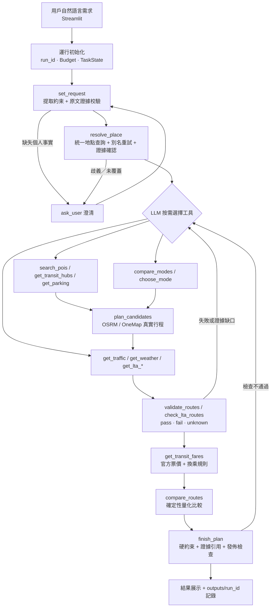

# RouteAgent 當前實現 Pipeline

整理日期：2026-10-10。依據當前代碼和倉庫中的驗收記錄。本次整理時離線測試集（不含 `tests/test_online.py`）共 316 項全部通過，沒有重新調用在線服務。

## 總體流程

**自然語言需求 → 需求提取與校驗 → 必要澄清／地點確認 → Agent 按需查詢 → 真實候選行程 → 逐項驗證 → 補查、查價與重規劃 → 比較、選擇與發佈檢查 → 網頁展示和運行記錄。**

這是按職責排列的閱讀順序。實際運行時，DeepSeek 根據當前狀態、工具反饋和剩餘預算決定下一步：地點檢索、POI 搜索、路線計算、交通、天氣和票價查詢可以交替進行，驗證後也可以繼續探索其他方式或候選。

可編輯流程圖：[route-agent-current-pipeline.drawio](route-agent-current-pipeline.drawio)。

## 1. 輸入與運行初始化

- 用戶在 Streamlit 頁面輸入自然語言行程；已有澄清可隨繼續規劃一起提交。
- `plan_route` 檢查非空輸入、在線模式、DeepSeek 思考模式及必要配置（`DEEPSEEK_API_KEY`、`ORS_API_KEY`），建立 `run_id`、`Budget`、`PlanningResult` 和 `TaskState`。
- 正常入口使用真實在線服務；自動化測試使用模擬模型和服務響應。
- 若 LTA 速度區間鏈接索引不存在或超過 7 天，後台啟動一次維護掃描（不計入行程證據和預算）；也可手動執行 `scripts/build_lta_link_index.py`。

對應：`app/streamlit_app.py`、`service.py`、`config.py`、`tools.py`、`lta_index.py`。

## 2. 理解需求並形成約束

- DeepSeek 通過 `set_request` 提取起終點、出發時間、到達時限、交通方式、經停用途、停留時間及偏好（如省錢、最快）。
- 後端校驗 `TravelRequest` 字段、原文證據、數值和單位，區分硬約束與軟偏好。非法或遺漏的提取返回模型修正。
- 保留原始地點描述；地圖未匹配不等於用戶沒有提供地點。用戶未限制方式時，`mode` 保持為空。
- 只澄清家庭／公司實際位置、車輛可用性、停留時間、停車轉換安排等無法得知的事實；泛指咖啡店、郵局、加油站等任務不要求用戶指定門店，也不用到達時限推斷停留時間。
- 需求成立後，模型不能在後續重規劃中擅自修改已確認約束。

輸出：帶原文依據的 `TravelRequest`，或 `needs_clarification`。

對應：`coordinator.py:set_request/ask_user`、`parser.py`、`models.py`。

## 3. 通用地點解析與證據確認

- 統一使用 `resolve_place`，由 Agent 選擇地圖、登記信息或通用網頁來源，並提出名稱、語言別名和拼寫檢索假設。
- ORS／Pelias 提供地圖位置；GLEIF 提供公司登記／總部地址線索；已配置的 Tavily／來源網頁補充名稱和地址線索，再由地圖服務定位。
- Agent 審閱真實候選相關性；後端核對候選 ID、網頁引用、名稱、來源及用戶確認。檢索假設不是座標證據，登記地址也不自動等於實際辦公室。
- 歧義地點提交用戶確認；繼續規劃時複用搜索記錄與已確認請求。來源覆蓋不足時保留失敗原因，不讓空結果覆蓋已有有效候選。

輸出：有來源、座標和證據 ID 的 `Place`，或明確的確認／覆蓋缺口。

對應：`coordinator.py:resolve_place`、`providers.py`、`company_locations.py`、`web_locations.py`。

## 4. Agent 按需獲取信息

| 需求／缺口 | 當前工具與來源 | 返回用途 |
| --- | --- | --- |
| 未限定交通方式 | `compare_modes`、`choose_mode`；OSRM、OneMap | 駕車／步行／公共交通直達參考與失敗原因；選擇只是臨時探索依據 |
| 經過某類設施或指定門店 | `search_pois`，OSM Overpass | 多個真實 POI；通用 OSM 類別、品牌／語言別名、有限搜索範圍 |
| 營業條件或道路屬性 | `get_opening_hours`、`get_roads`，OSM | 來源標籤；缺失時保持未知 |
| 自駕時間、擁堵要求 | `get_traffic`，LTA | 速度區間、事故、分頁完整性、路線匹配覆蓋率；有索引時只讀取候選幾何覆蓋的頁 |
| 停車後步行 | `get_parking`，LTA | 真實停車點與當前餘量；後續仍需轉換點核驗 |
| 天氣、避雨需求 | `get_weather`，Open-Meteo；NEA 可補充 | 沿路線有限採樣與預計行程時段的預報 |
| 公共交通接駁缺口 | `get_transit_hubs`，OneMap | 真實 MRT／LRT 或公交站點 ID 和位置 |
| 公交、地鐵運行狀態等 | `get_lta_catalog/get_lta_data/check_lta_routes/get_lta_image` | 33 類動態數據目錄、實際查詢記錄及與路線的核對 |
| 公共交通整程票價 | `get_transit_fares`，LTA 官網票價計算器、PTC 換乘規則、Sentosa 營運方 | 成人交通卡標準票價參考、分段金額、累積計費狀態及缺口 |

每次查詢記錄來源、獲取時間、證據 ID、響應哈希和緩存狀態；動態數據另外核對觀測時間、有效時段與讀取完整性。Agent 不會為每條行程固定查詢所有接口。

**LTA 定向交通讀取**：`lta_speedband_index.json` 只保存 LinkID → 頁偏移和鏈接幾何，不保存速度。行程使用的速度值始終實時讀取；索引只讓 `get_traffic` 在 `plan_candidates` 返回駕車路線後讀取沿線頁（默認最多 40 頁，`continue_collection` 時加倍，最多續讀兩次），新增駕車幾何時只補讀新頁。

對應：`providers.py`、`lta_data.py`、`lta_index.py`、`traffic.py`、`weather.py`、`poi_categories.py`、`fares.py`。

## 5. 生成完整候選行程

- `plan_candidates` 只接受已知的真實 POI、停車點、站點 ID 和候選方式。
- OSRM 計算駕車／步行幾何、距離及基礎時間；OneMap 返回公交／地鐵／步行組合、服務時刻和可用票價證據。OneMap 返回 `fare: "info unavailable"` 時保留通過幾何、端點、換乘與時序檢查的行程，票價記為未知。
- 未限制方式時，探索步行、公共交通及用戶確認車輛可用後的自駕。`choose_mode` 不鎖定最終方式。
- 類別經停圍繞真實參考路線搜索多個 POI（首批 10 家，擴大後最多 30 家），計算實際經停行程並比較繞行。
- 公共交通經停逐段查詢，後一段按前一段到店時刻和用戶停留時間重新查詢；需要時補充真實站點接駁和換乘步行。
- 完整候選累計行駛、步行、候車／換乘、業務停留及適用的停車預留。
- 每個方式的搜索批次共用 45 秒預算（含路線請求、重試和請求間隔），單批最多探索 10 個組合。每個組合分別記錄成功和失敗，達到邊界時保留已完成候選並記錄有限搜索。

輸出：`RouteCandidate[]`，包含 `RouteLeg[]`、幾何、服務指標、時序、來源和證據。

對應：`coordinator.py:plan_candidates`、`providers.py:routes`、`routing.py`、`transit.py`。

## 6. 後端驗證與 Agent 重規劃

後端通過 `validate_routes` 檢查實際交通方式、車輛可用性、分段連接、公共交通時序、必經 POI、累計步行、營業、停車、時間限制、擁堵和天氣證據。公共交通還通過 `check_lta_routes` 核對真實站點、線路和有效時段。

每項檢查返回 `pass / fail / unknown` 和證據依據。候選硬約束全部通過時為 `verified`；有硬約束失敗為 `violated`；有硬約束未知為 `unverified`。

驗證結果反饋給 DeepSeek，由模型決定補查證據、嘗試其他真實門店／站點／交通方式、擴大有限搜索、請求必要確認或結束。每個方式追加重規劃前必須檢查上一批候選，重複組合不再查詢，已確認約束繼續有效。

### 預算與收尾保護

| 項目 | 默認值 |
| --- | --- |
| 模型交互輪數 | 16 |
| 工具調用 | 32（最後 4 次預留給核驗與完成） |
| 外部請求 | 128（最後 16 次預留） |
| 總時間 | 240 秒（最後 60 秒預留） |
| 單方式搜索批次 | 45 秒 |
| 單批查價 | 15 秒 |
| 每個方式追加重規劃 | 2 輪 |

- 每輪把剩餘時間、外部請求、工具調用和模型輪數作為 `planning_budget` 附在最新工具結果中，接近邊界時提示模型核驗並完成已有候選；穩定的系統及歷史前綴保持不變。
- 進入預留階段後拒絕新的門店／站點搜索，只允許核驗、查價、比較和 `finish_plan`；未完成的方式比較如實記錄，不冒充全部方式已比較。
- 模型錯誤分類為超時、總預算耗盡、連接、鑑權、餘額及限流，保存異常類型、HTTP 狀態、輪數與超時預算，不保存原始消息、響應體或憑據。

後端不代替 LLM 選路，也不因預算放寬硬約束或證據要求。

對應：`verification.py`、`traffic.py`、`lta_verification.py`、`coordinator.py`、`tools.py`、`config.py`。

## 7. 票價核實

- `get_transit_fares` 對最多三個已知完整公共交通候選查價；省略 ID 時取服務時間最短的三個，不生成新路線。
- 公交線路、方向與站序必須唯一匹配真實站碼；MRT/LRT 使用官方目錄支持的車站編號。金額和計費距離取自官方返回值，不用幾何距離套價，不寫死票價表。
- 按 PTC 換乘規則核對首末上車間隔、換乘次數、實際下車至上車間隔（含步行、等待和購物停留）、同號公交及重新進入同一車站；符合時傳遞累積計費狀態，不符合時重置。業務經停不合併為連續換乘。
- Sentosa Express 等特殊服務單獨讀取營運方官網標準票價；來源未核實的方向或服務保持未知。
- 區分完整總價與已核實部分小計；任一段缺失不得把小計當總價。過期或缺失票價證據失效，不能繼續用於比較。
- 默認是標明的成人交通卡標準票價參考，不推斷個人優惠資格，不含時段優惠、通票與支付附加費。

對應：`fares.py`、`coordinator.py:get_transit_fares`。

## 8. 比較、選擇與發佈檢查

- `compare_routes` 重新驗證候選並給出確定性量化比較；按請求考慮時間、距離、擁堵、不確定性、費用與天氣潛在暴露參考。
- DeepSeek 閱讀真實候選指標和檢查結果，選擇推薦／備選 ID（最多 2 個備選）與理由代碼。
- `finish_plan` 再次檢查硬約束、相關服務是否嘗試查詢、自動方式比較是否完成，以及每段路線和推薦理由的證據引用。缺少整程票價的正式推薦／備選必須先嘗試 `get_transit_fares`；以 `cost` 為理由時必須引用真實票價證據。
- 未通過硬約束的候選不能成為正式推薦。硬約束通過的推薦仍可能因軟偏好或比較缺口（例如省錢偏好下仍有票價未知）使整次 `PlanningResult.status` 為 `unverified`。
- 最終解釋文本由後端 `ranking.explain` 按服務事實和檢查結果生成，避免模型自由補造數值。

終態包括：`needs_clarification`、`verified`、`unverified`、`search_exhausted`、`tool_error`。有限搜索未找到方案和服務未完成必須區別報告。

對應：`ranking.py`、`coordinator.py:compare_routes/finish_plan`。

## 9. 展示與可追溯記錄

- 網頁顯示階段進度、澄清表單、推薦和備選、地圖、完整行程分段、經停信息、指標、票價明細（完整總價或已核實小計）、逐項檢查、實際查詢來源和未核實項，並支持導出 JSON。
- 每次運行保存到 `outputs/<run_id>/`：`result.json`、`events.jsonl`、`manifest.json`；異常時可另有 `diagnostic.json`。
- 記錄模型配置、候選數量、調用次數、耗時、重規劃次數、緩存命中、證據哈希及代碼哈希，便於複查和後續評測。

對應：`app/streamlit_app.py`、`service.py:save_result`。

## 當前完成程度與邊界

| 內容 | 當前證據 |
| --- | --- |
| 原生工具決策、需求守衛、真實服務、驗證和發佈閉環 | 已實現；倉庫有協議／行為迴歸及真實網頁個案 |
| 自動類別經停 | 真實麵包店個案搜索 10 家、生成 22 條候選並完成選擇；通用類別擴展有迴歸及真實提取證據 |
| 組合出行與業務經停 | 真實郵局網頁個案搜索 3 家、生成 24 條完整候選；推薦包含步行、公交、地鐵及停留，避雨缺口保留 |
| LTA 動態數據 | 33 類小範圍查詢取得真實響應或文件清單；存在文件大小、掃描、分頁和時段邊界 |
| LTA 定向速度區間讀取 | 已實現鏈接索引與沿線頁讀取；索引只含幾何，速度仍實時讀取 |
| 公共交通狀態核對 | 真實 Chinatown MRT → Bayfront 網頁個案查詢運營通告並與路線核對 |
| 公共交通票價 | 對已保存真實推薦行程官方查價：公交 30 S$1.59、換乘地鐵追加 S$0.09、Sentosa 入島 S$4.00，完整參考價 S$5.68（`outputs/fare-check/result.json`）；未重跑完整在線 Agent |
| 收尾超時修復 | 用失敗運行保存的 OneMap 響應離線回放，原被拒絕的查詢保留 3 條行程，票價未知；修復後的 DeepSeek 全程在線驗收尚未完成 |
| 通用網頁地點來源 | 有實際 Tavily／Pelias 地點候選證據；特定案例只到用戶確認階段，不能算整條行程成功 |
| 尚未完整支持或驗收 | 多個業務經停；獨立最快／最短／避高速策略接口及支持實例；未來駕車交通預測；自駕費用、優惠票價、全程遮蔽、廣泛場景質量與新版統一真實評測 |

OSRM 基礎時間不是實時 ETA；部分 LTA 覆蓋估計不能驗證完整駕車硬時限；天氣預報和方式名稱不能證明全程不淋雨；LTA 票價計算器後端不是有版本承諾的公開 API，結構變化時會保留缺口。上述真實個案證明對應流程可運行，不代表所有地點、交通組合或實時條件均已覆蓋。

依據：[項目目標](PROJECT_GOALS.md)、[自動 POI 驗收](AUTONOMOUS_POI_FIX.md)、[通用地點設計](LOCATION_SEARCH_DESIGN.md)、[組合出行驗收](MULTIMODAL_PLANNING_FIX.md)、[LTA 接入與驗收](LTA_INTEGRATION.md)、[預約出行檢查](SCHEDULED_TRIP_VERIFICATION.md)、[DeepSeek 收尾超時修復](DEEPSEEK_TIMEOUT_FIX.md)、[票價核實](TRANSIT_FARE_FIX.md)。
